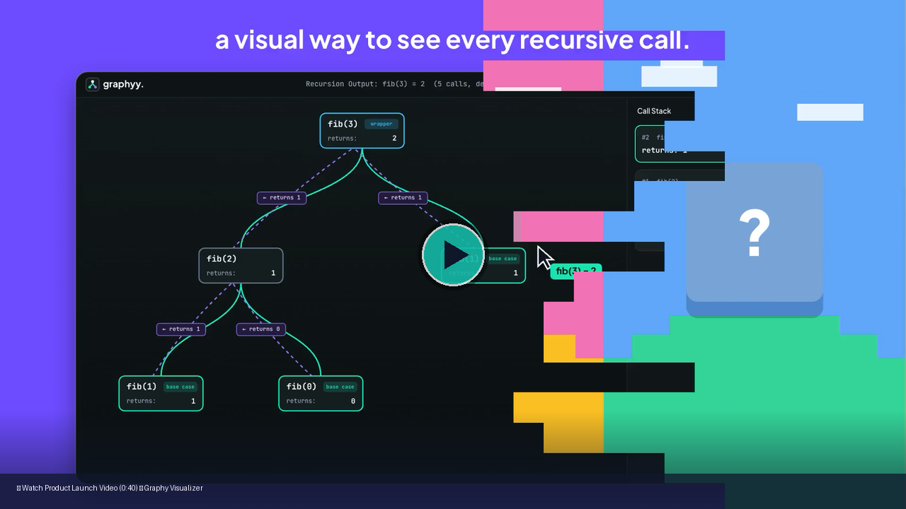

  
  <h1>Graphy (graphyy.xyz)</h1>
  
<strong>Interactive Recursion Tree Visualizer & Call Stack Simulator</strong>

  

    <a href="https://graphyy.xyz"><strong>Explore Live Web App »</strong></a>
  

---

## Overview

**Graphy** is a browser-based visualization tool designed to help developers and computer science students understand how recursion works without drawing out manual trees on paper. 

Paste any recursive function written in **C++**, **Python**, or **Java**, and Graphy creates a call tree diagram and step-by-step stack timeline in real time.

- **Live Application**: [https://graphyy.xyz](https://graphyy.xyz)
- **Author**: Anmol Tiwari ([Portfolio](https://bilkulanmol.vercel.app) | [GitHub](https://github.com/anmoltiwari0712))

---

## 🎬 Product Launch Video

> 💡 **Click the preview above to play the official launch demo video**, or download the source video: [assets/graphyy-product-launch.mp4](assets/graphyy-product-launch.mp4).

---

## What Graphy Does

1. **Automatic Language Detection**: Detects whether you pasted C++, Python, or Java and configures the runner automatically.
2. **Interactive Call Tree**: Draws every recursive branch with clear forward-call links and return value paths.
3. **Timeline Playback**: Step forward, step backward, or play the execution sequence like a video to inspect how each frame is placed on the call stack.
4. **LeetCode Binary Tree Visualizer**: Automatically parses level-order tree arrays into linked node structures and highlights the current node being evaluated during recursion.
5. **Base Case & Return Values**: Highlights when a base condition is hit and tracks return values as they travel back up the tree.
6. **One-Click Export**: Save and download diagrams as PNG images for interview notes and documentation.

---

## Supported Patterns

- **Classic Recursion**: Factorial, Fibonacci, GCD, Tower of Hanoi
- **Divide and Conquer**: Merge Sort, Binary Search, Fast Power
- **Binary Tree DFS**: Tree traversals, Max Depth, Same Tree, Invert Tree, Symmetric Tree, Lowest Common Ancestor
- **Backtracking**: Subsets, Permutations, Combination Sum

---

## Quick Links & SEO Metadata

- **Website**: [https://graphyy.xyz](https://graphyy.xyz)
- **Developer**: [Anmol Tiwari](https://bilkulanmol.vercel.app)
- **Coverage**: Worldwide (Free & Client-Side)
- **License**: MIT
